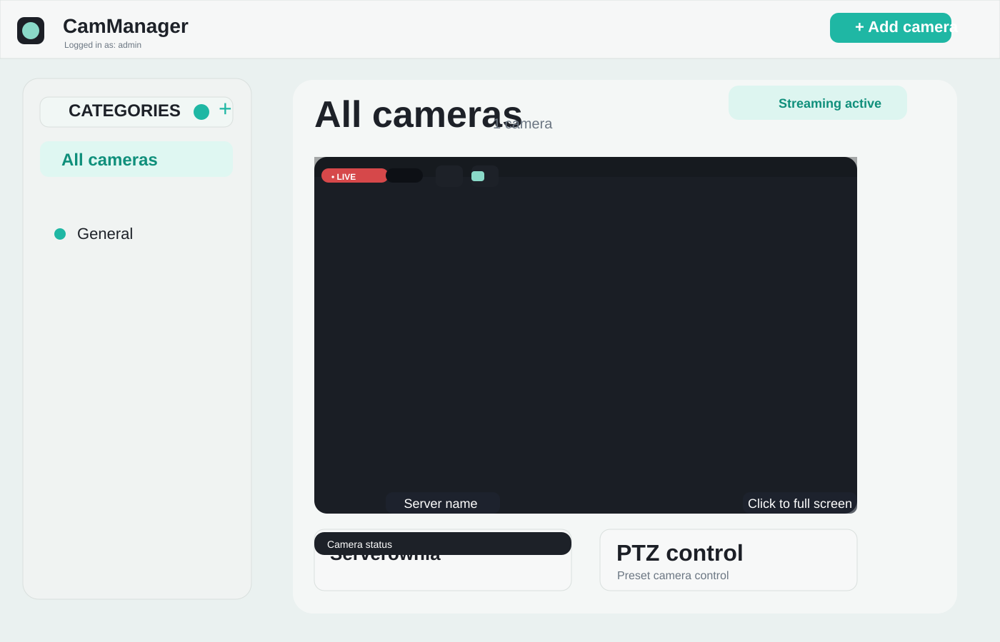
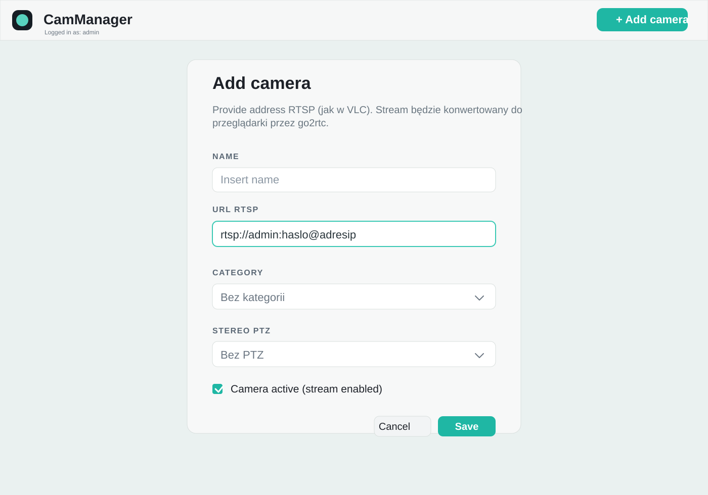

# CamManager

CamManager is a lightweight camera management dashboard designed to monitor and control RTSP sources in a single interface. It helps operators manage live streams, categorize devices, and access PTZ controls directly from the browser.

## Overview

This project focuses on a front-end dashboard for viewing and organizing connected cameras, with the ability to:

- add cameras using RTSP source URLs
- group cameras into categories
- manage a live stream viewer
- use PTZ controls for compatible devices
- keep an admin-friendly management overview

The interface in the screenshots below shows a clean, modern control panel for camera administration and real-time monitoring.

## Features

- live camera catalog overview
- camera categories and filtering
- RTSP URL support for ingestion
- browser-based stream preview
- PTZ navigation controls
- active/inactive camera toggles
- admin login and session-aware layout

## Screenshots

### Dashboard



### Add camera form



## Project structure

```text
.
├── docs/
│   └── screenshots/
│       ├── dashboard.svg
│       └── add-camera.svg
├── public/
├── scripts/
├── src/
│   ├── app/
│   ├── components/
│   └── lib/
├── .gitignore
├── README.md
└── package.json
```

## Typical setup

Install dependencies and run the application in your preferred framework environment:

```bash
npm install
npm run dev
```

If the project is used with Next.js, the app is usually served on:

```text
http://localhost:3000
```

## Environment and configuration

Configure the backend connection and camera stream source details according to your deployment environment, including:

- RTSP stream source URLs
- camera metadata
- PTZ device parameters
- authentication settings for the admin panel

## Use cases

CamManager is well suited for:

- office and building surveillance dashboards
- remote video monitoring rooms
- security control panels
- PTZ camera management in internal networks

## License

This project is provided as a template / internal dashboard implementation. Add your preferred license before publishing externally.

## Notes

The UI design shown here is intended to represent the project visually and is organized for GitHub presentation. Update the configuration and runtime details with your actual app stack before public release.
